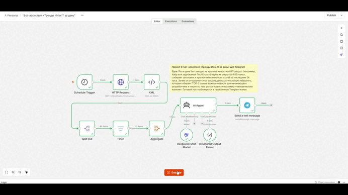

# 🤖 Бот-ассистент «Тренды ИИ и IT за день» для Telegram

Автоматизированный сценарий n8n для ежедневного мониторинга RSS-ленты Хабра (`habr.com/ru/rss/flows/backend/articles/`), фильтрации публикаций за последние 24 часа и генерации дайджеста. Нейросетевой агент на базе модели DeepSeek анализирует массив статей, отбирает ТОП-3 наиболее ценных материала для начинающего разработчика и формирует готовый HTML-пост с краткими выжимками и ссылками для публикации в Telegram-канал.

## 🚀 Ключевые возможности

- **Автоматический сбор и парсинг**: Загрузка XML-ленты RSS по расписанию и преобразование структуры в нативные JSON-объекты через связку `HTTP Request` и `XML` нод.
- **Строгая временная фильтрация**: Валидация и фильтрация статей по полю `$json.pubDate` со строгим условием `after` относительно точки `$now.minus({ hours: 24 })`.
- **Интеллектуальная агрегация и отбор**: Объединение нормализованных элементов (`Split Out` → `Filter` → `Aggregate`) в единый массив входных данных для исключения множественных вызовов LLM.
- **Гарантированная схема ответов (Structured Output)**: Использование `Structured Output Parser` в связке с `AI Agent` для получения строго типизированного JSON-массива (`title`, `link`, `summary`, `pubDate`) без галлюцинаций и мусорных метаданных.
- **Форматированная доставка контента**: Публикация чистого HTML-сообщения с кликабельными ссылками на оригинальные статьи и отключенным предпросмотром страниц (`disable_web_page_preview: true`).

## 📦 Быстрый старт и установка

### Предварительные требования

- Развернутый экземпляр n8n (версия с поддержкой `@n8n/n8n-nodes-langchain`).
- API-ключ к DeepSeek (`DeepSeek API Credential`).
- Бот в Telegram с полученным токеном через [@BotFather](https://t.me/BotFather) (`Telegram API Credential`).
- Telegram-канал, куда бот добавлен в качестве администратора с правами публикации.

### Пошаговый запуск

**👉[Скачайте готовый JSON-шаблон](trends_of_dayBot_templateJSON.md)**

1. **Импорт сценария**:
   - Скачайте файл `trends_of_dayBot_template.md` (или скопируйте его содержимое в формате JSON).
   - В интерфейсе n8n откройте меню **Workflows** → **Import from File / Paste JSON**.
2. **Настройка учетных данных (Credentials)**:
   - В узле **DeepSeek Chat Model** выберите или создайте учетную запись DeepSeek API.
   - В узле **Send a text message** выберите учетную запись Telegram Bot API.
3. **Конфигурация узлов**:
   - В узле **Send a text message** замените значение параметра `chatId` (`YOUR_TELEGRAM_CHAT_ID`) на адрес вашего канала (например, `@your_channel_name` или числовой ID вида `-100...`).
   - В узле **Schedule Trigger** настройте желаемый час запуска (по умолчанию установлен запуск раз в день в `07:00`). Убедитесь, что часовой пояс инстанса выставлен корректно в `Settings` → `Timezone`.
4. **Тестирование и активация**:
   - Нажмите **Execute workflow** для тестового прогона пайплайна.
   - После успешной отправки сообщения переведите переключатель сценария в положение **Active**.

## 🛡️ Обработка краевых случаев (Edge Cases)

| Сценарий | Поведение системы | Результат |
| :--- | :--- | :--- |
| **Отсутствие новых статей за 24 часа** | Нода `Filter` отсекает все элементы, передавая на `Aggregate` пустой массив | Пайплайн завершает работу на этапе фильтрации, предотвращая лишние запросы к DeepSeek API |
| **Нестандартный формат ответа LLM** | `Structured Output Parser` принудительно валидирует JSON по схеме `jsonSchemaExample` | Исключение сбоев шаблонизатора n8n; на ноду отправки поступает строго типизированный массив объектов |
| **Длинные ссылки или спецсимволы в тексте** | Нода Telegram экранирует HTML-сущности и использует параметр `disable_web_page_preview: true` | Сообщение публикуется компактным блоком без раздувания превью-карточками статей |
| **Сетевые сбои при загрузке RSS** | `HTTP Request` получает сетевой таймаут или статус `5xx` от источника | Выполнение прерывается с фиксацией ошибки в журнале executions без отправки поврежденного поста |

## 📊 Метрики эффективности

| Параметр | Значение | Примечание |
| :--- | :--- | :--- |
| **Среднее время исполнения** | `~3.5 – 6.0 сек` | Зависит от скорости генерации и времени отклика DeepSeek API |
| **Частота запуска** | `1 раз в сутки` | Регулируется триггером `Schedule Trigger` (default: 07:00) |
| **Обработка входного потока** | `40 items → 17 items` | Средний срез: нода `Filter` оставляет ~40–50% суточных публикаций |
| **Потребление токенов LLM** | `~1,200 – 2,500 токенов` | Агрегированный батч `title, category, description` в одном промпте |
| **Ориентировочная себестоимость** | `< $0.001 за запуск` | Использование оптимизированной модели `DeepSeek Chat` |

## 📬 Контакты

- **Автор**: Kodzhi Tanaka
- **Telegram**: [@TanakaKodzhi](https://t.me/TanakaKodzhi)
- **Telegram-канал**: [Build -> Запуск](https://t.me/tanaka_dev)
